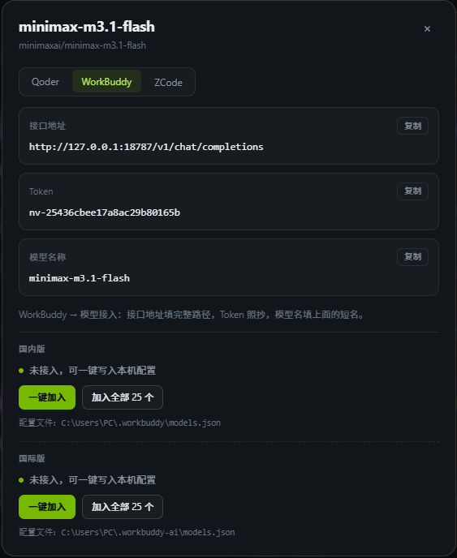

# NVIDIA 免费模型 + OpenAI 兼容网关

把 build.nvidia.com 上可用的免费模型整理成一个本地网页，同时提供 OpenAI 兼容接口。

需要注册nvidia模型账号，不需要绑卡，但要绑定手机号(支持中国手机号)，免费使用，没有额度限制(但有速率限制，每分钟40次请求)，个别模型速度一般，deepssek4.1经常会超时(应该是使用的人太多了，排队)。

做这个项目，最初是因为把 NVIDIA 模型加到 WorkBuddy 后调不通：它会带一些 NVIDIA 不认的额外参数，直接返回 400，后来还发现Qoder、ZCode 也存在同样的问题。

网关在中间把这些额外参数剥掉，再统一模型名和鉴权；后来又做了一键写入 Qoder / WorkBuddy（国内版、国际版）/ ZCode 配置。

需要说明的是客户端DeepSeek Hermes、OpenCode、Trae都支持直接使用 NVIDIA API，不需要经过这个网关。

单进程、零第三方依赖、一份配置，Windows / macOS / Linux 都能运行。

一般推荐在本机使用：网页、网关和客户端都在同一台电脑上，不用开放端口，密钥也不出本机；只有需要给多台设备共用时才需要部署到服务器。

演示地址：[https://model.lovefc.cn](https://model.lovefc.cn)

线上不能直接写入本机配置，可以手动复制，或下载 .bat / .sh 脚本执行。

完整版请本地运行代码，也更快，单人申请个NVIDIA API Ke应该够用了。

测速功能是测试在当前网络下，哪个模型更快，免费端点有排队和限流，测速结果只适合横向参考。

克隆此仓库到本地，如果你懒得看使用介绍，直接让AI给你启动就行，不会git或者怕麻烦，你可以直接用这句提示词告诉AI: 请帮我下载这个https://github.com/lovefc/nv-models.git仓库，并且启动它运行。

现在的AI非常方便了，没有菜鸟，都是天才。

搁以前，我会说不会就去学，现在学都不需要了，会说话就行，估计AI再发展两年会更离谱。



## 能做什么

- **免费模型目录**：自动采集 NVIDIA 免费端点模型，并过滤掉没有 API ID、实际无法调用的条目。
- **中文简介**：英文模型介绍自动翻译成中文，使用必应免费接口，无需额外配置。
- **搜索与筛选**：按名称、发布方、标签搜索，可按发布方筛选，并按发布时间、名称排序。
- **接入信息**：每个模型都能查看 API 地址、模型名和访问口令；本机访问时支持一键写入 Qoder / WorkBuddy（国内版、国际版）/ ZCode 配置，远程访问时可以下载本地配置脚本，在运行客户端的电脑上执行。网页会识别操作系统：Windows 下载双击即用的 `.bat`（内置 PowerShell，无需 Python），Linux / macOS 下载 `.sh`。
- **测速与按速度排序**：单个模型一键测首字延迟、生成速度和总耗时，结果保存在本地，后台可自动重测；模型列表可按首字速度、生成速度排序，直接挑出当前最快的模型。
- **自动刷新列表**：默认每 8 小时检查一次，可关闭或改成 1 小时到 3 天。
- **首次配置页面**：第一次使用时在网页里填写 NVIDIA API Key、网页访问口令、API 访问口令和刷新间隔，口令可随机生成，保存后自动写入配置并立即生效。
- **访问保护**：网页使用独立登录页，输入口令后登录状态保留 7 天，页面右上角可退出；API 使用单独的访问口令。适合局域网或公网部署；公开访问时可以隐藏手动刷新按钮，避免访客反复触发采集。
- **OpenAI 兼容 API**：默认与本机网页一起启动，客户端按标准 OpenAI 接口接入，不需要额外安装网关程序。

## 运行环境

需要 Node.js 20.18 或更高版本，不需要安装任何依赖包。

## 本地启动、关闭与重启

安装 Node.js 20.18+ 后，在项目目录执行：

```bash
npm start        # 后台启动
npm run status   # 查看运行状态
npm restart      # 重启
npm stop         # 停止（暂停）
```

`npm start` 启动后可以直接关闭命令行窗口，服务继续在后台运行，日志写在 `logs/server.log`。想启动后自动打开浏览器，用 `npm run start:open`。

需要在前台看实时日志时，用 `npm run dev` 或 `node src/server.mjs`，按 `Ctrl+C` 停止。npm 本身没有 `npm status` 这个简写，查看状态请用 `npm run status`。

`npm stop` 会按 PID 记录停止；记录丢失或过期时，会自动找到占用 18788/18787 的本项目进程再停止，不会误杀其他程序。

启动后：

- 网页：<http://127.0.0.1:18788>
- API：<http://127.0.0.1:18787/v1/chat/completions>

如果还没有配置 NVIDIA API Key，网页会自动进入首次配置引导，按提示填写即可。

修改 `.env` 中的端口、口令等配置后需要执行 `npm restart`；在网页里保存的配置会自动生效，不用重启。

配置、模型缓存和测速结果都保存在项目目录中，停止或重启不会丢失。

## 部署到服务器

1. 准备一台安装好 Node.js 20.18+ 的 Linux 服务器。
2. 上传或解压项目，使用 root 运行安装脚本：

   ```bash
   sudo bash deploy/install.sh
   ```

3. 安装脚本会创建独立的运行账号、注册开机自启的 `nv-models` 系统服务，并生成网页与 API 的访问口令。
4. 直接用 IP 访问时，在防火墙或安全组放行 18788（网页）和 18787（API）；绑定域名时只需放行 80/443，见下文“绑定域名”。
5. 浏览器打开网页，用配置里的网页口令登录，再按引导填写 NVIDIA API Key 即可开始使用。

安装完成后，用系统服务管理：

```bash
sudo systemctl status nv-models     # 查看状态
sudo systemctl stop nv-models       # 停止
sudo systemctl start nv-models      # 启动
sudo systemctl restart nv-models    # 重启
sudo journalctl -u nv-models -f     # 查看实时日志
```

服务器上已由系统服务托管，请使用上面的 `systemctl` 命令，不要再执行 `npm start`。

### 绑定域名（一条命令）

一个域名、一张证书就能同时提供网页和 API，不用配两个域名或两张证书。

前提：

1. 域名已解析到这台服务器（A 记录指向服务器公网 IP）。
2. 服务器上已有该域名的 HTTPS 证书。没有证书时，可以在宝塔面板“网站 → 设置 → SSL → Let's Encrypt”申请，或执行 `sudo certbot certonly --nginx -d 你的域名` / `sudo acme.sh --issue --nginx -d 你的域名`。

然后在服务器上执行：

```bash
sudo bash /opt/nv-models/deploy/bind-domain.sh 你的域名
```

脚本会自动完成：

- 识别宝塔面板或标准 nginx 的站点配置目录，并查找该域名已有的证书；
- 生成一个域名同时代理网页和 API 的 nginx 配置；
- 备份并修改 `/opt/nv-models/.env`，把服务改为只监听本机，并设置公开访问地址和代理头；
- 检查 nginx 配置、重启 `nv-models`、重载 nginx；
- 用 HTTPS 检查网页和 API，任何一步失败都会自动恢复到执行前。

完成后：

- 网页：`https://你的域名/`
- API：`https://你的域名/v1/chat/completions`
- 防火墙或安全组只放行 80 和 443，18787、18788 不再对公网开放。
- 客户端里原来填 `IP:18787` 的，改成 `https://你的域名/v1`。

如果该域名已经有 nginx 配置（例如宝塔面板先建了站点），脚本会提示是否覆盖，覆盖前会自动备份，确认继续即可。

脚本会自动设置 `NV_TRUST_PROXY=1`，只信任本机反代传来的真实客户端 IP，不需要手动改。它只会处理 nginx 和 nv-models，不会改防火墙，也不会碰服务器上的其他站点。

证书不在常见位置时，手动指定：

```bash
sudo bash /opt/nv-models/deploy/bind-domain.sh 你的域名 \
  --cert /path/fullchain.pem --key /path/privkey.pem
```

想先看会改什么（不写文件、不重启）：

```bash
sudo bash /opt/nv-models/deploy/bind-domain.sh 你的域名 --dry-run
```

其他选项用 `--help` 查看。手动配置示例仍保留在 `deploy/nginx.conf.example`。

升级时解压新版本后重新运行安装脚本，已有的配置、模型缓存和测速结果不会被覆盖。

## 日常使用

1. 第一次打开网页，按引导填写 NVIDIA API Key。Key 可以在 build.nvidia.com 免费创建。需要限制面板访问时，在同一页设置网页访问口令。
2. 在模型卡片上点“接入”，可以查看并复制 API 地址、模型名和 Token。
3. 在本机打开的页面里，可以把模型直接添加到 Qoder、WorkBuddy 或 ZCode，加完可能需要重启对应客户端才能看到模型。
4. 部署在 Linux 服务器、远程打开页面时，在弹窗里下载配置脚本，回到运行客户端的电脑执行即可写入：Windows 下载 `.bat`，双击运行，使用系统自带 PowerShell，不需要安装 Python；Linux / macOS 下载 `.sh`，执行 `bash nv-workbuddy-ai-模型名.sh`（需要 python3）。脚本文件名按 `nv-客户端-模型名` 生成，全部模型为 `nv-客户端-all`，例如 `nv-qoder-mistral-large-4-1t-a52b.bat`、`nv-qoder-all.bat`。脚本里含有 API Token，用完请删除。
5. 需要比较模型速度时，点单个模型的“测速”按钮；页面右上角可以手动刷新模型列表。公开访问时可以在设置页或 `.env` 里把 `NV_MODELS_SHOW_REFRESH` 设为 `0`，隐藏刷新按钮并关闭远程手动刷新。

## 网页设置

页面右上角“设置”（设置网页口令后需先登录）可以直接修改常用项，保存后立即生效：

- NVIDIA API Key、网页访问口令、API 访问口令
- 自动采集间隔、手动刷新按钮显示
- 测速、后台自动测速间隔、简介翻译
- 设置页本身的开关

刷新、测速和后台自动测速默认开启，后台默认每 24 小时重扫一次过期结果。端口、监听地址、HTTPS、反向代理等需要重启的项仍然在 `.env` 里修改。设置页只有服务器本机或已登录用户可以保存；网页访问口令修改后需要重新登录。

不想让别人打开设置页时，可以在设置页里把“网页设置页”设为关闭，或直接在 `.env` 中设置 `NV_MODELS_SETTINGS=0` 并重启服务。关闭后右上角设置按钮、设置页面和保存接口都会关闭，只能通过把 `.env` 里的 `NV_MODELS_SETTINGS` 改回 `1`（或删除这一行）并重启来恢复。全新部署还没有 NVIDIA API Key 时，首次配置页仍会保留，避免把自己锁在外面。

## 配置说明

默认只需要一个 NVIDIA API Key，其余配置可以全部不填。端口、网页访问口令、API 访问口令、自动刷新、刷新按钮开关、测速、后台自动测速间隔、翻译、设置页开关、HTTPS 等选项都在 `.env.example` 里有中文注释，首次配置页和设置页也会自动写入常用项。

网页访问口令是 `NV_MODELS_TOKEN`：设置后打开网页会进入登录页，输入口令即可，登录状态保留 7 天，右上角“退出”可立即清除。登录凭据由服务端签名，签名密钥保存在 `data/session-secret`；修改网页口令会让已登录的浏览器重新登录。API 访问口令是 `AUTH_TOKEN`，用于 Qoder / WorkBuddy / ZCode 的 API Key，会直接显示在接入弹窗里；它只保护网关调用，不会暴露 NVIDIA API Key。两者互相独立，忘记网页口令可以直接查看 `.env`。

`.env` 里保存着密钥和访问口令，不要提交到代码仓库，也不要在截图或日志中公开。

## 安全提示

- 部署到局域网或公网时，务必设置网页和 API 的访问口令。
- 本机使用可以不设口令；服务器部署脚本默认会生成口令并开启校验。
- NVIDIA Key 只保存在服务端，网页不会把完整 Key 返回给浏览器。
- 登录会话保存在浏览器 Cookie 中（HttpOnly），HTTPS 下自动加 Secure；`data/session-secret` 是签名密钥，不要公开或打包分享。
- 请遵守 NVIDIA 的服务条款，不要滥用免费额度。

## 项目结构

- `src/server.mjs`：服务入口，同时提供网页和 API。
- `src/service.mjs`：本地的启动、停止、重启与状态命令。
- `src/setup-script.mjs`：生成远程访问时下载的客户端配置脚本。
- `src/gateway.mjs`：OpenAI 兼容网关。
- `src/collector.mjs`：模型采集与中文翻译。
- `src/benchmark.mjs`：模型测速。
- `src/clients.mjs`：Qoder / WorkBuddy（国内版、国际版）/ ZCode 客户端配置。
- `src/env.mjs`、`src/request-ip.mjs`：配置加载与真实 IP 解析。
- `public/`：网页界面、首次配置与设置页面。
- `tools/`：命令行客户端配置工具。
- `deploy/`：Linux 安装脚本、systemd 服务配置、一键绑定域名脚本和 nginx 反向代理示例。
- `data/`：模型缓存、翻译缓存和测速结果。
- `logs/`：运行日志。

## 开源说明

这是一个开源项目，2026 by lovefc（<https://github.com/lovefc>），欢迎提交问题和改进。使用前请先阅读 NVIDIA 的相关服务条款，感谢 NVIDIA 提供的免费服务。
